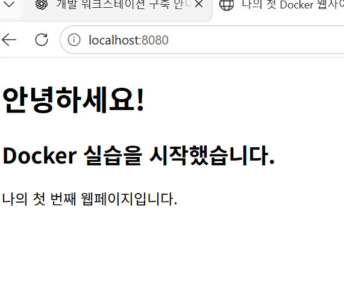
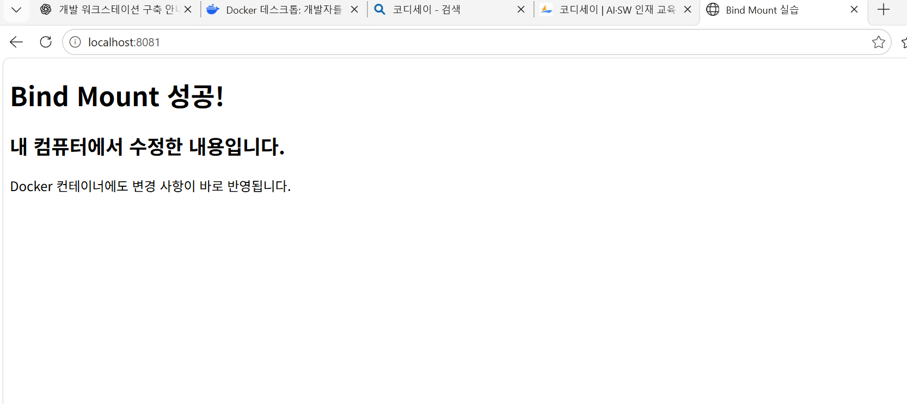
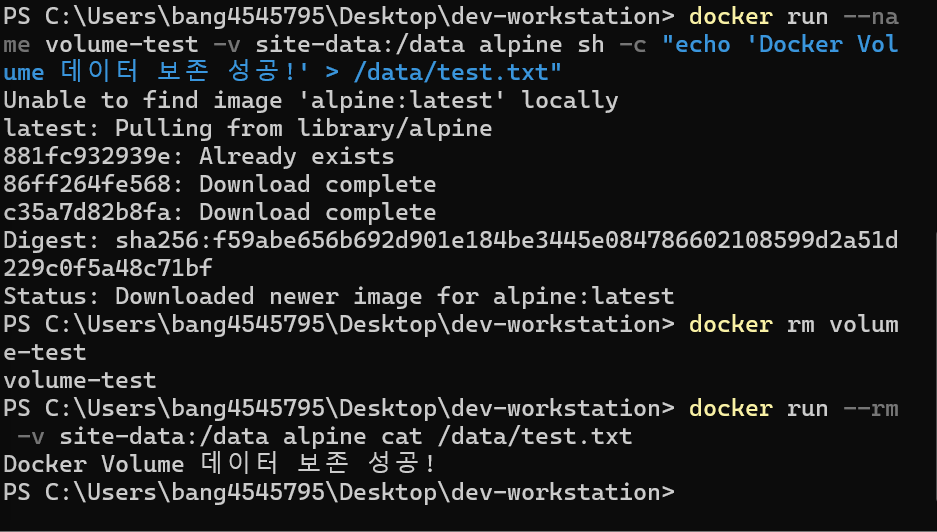
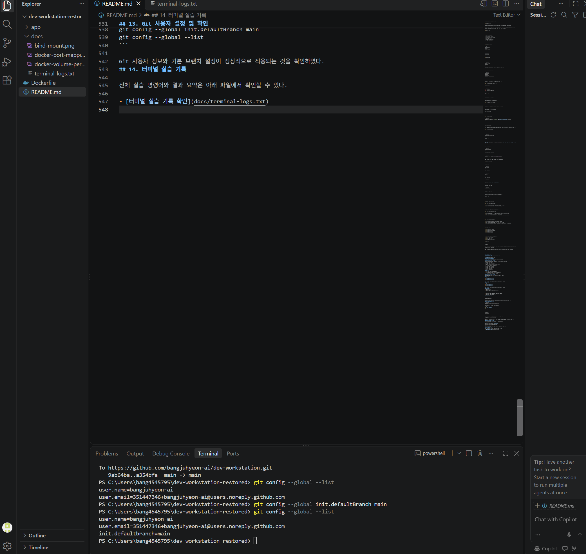

\# Docker 기반 개발 워크스테이션 구축


\## 1. 프로젝트 소개


본 프로젝트는 Windows 환경에서 Docker와 Git을 활용하여 개발 워크스테이션을 구축하는 실습이다.


Docker를 이용해 웹 서버를 실행하고, 포트 매핑, Bind Mount, Docker Volume 등의 기능을 실습하였다. 또한 Git과 GitHub를 연동하여 프로젝트 파일을 버전 관리하고 원격 저장소에 업로드하였다.


\## 2. 개발 환경


| 구분 | 사용 환경 |

|---|---|

| 운영체제 | Windows 11 |

| 터미널 | Windows PowerShell |

| 컨테이너 플랫폼 | Docker Desktop |

| Docker 버전 | 29.9.3 |

| Git 버전 | 2.56.0.windows.4 |

| 웹 서버 | Nginx (Alpine) |

| 버전 관리 | Git / GitHub |


\## 3. 프로젝트 폴더 구조


```text

dev-workstation/

├── app/

│   └── index.html

├── docs/

├── data/

├── Dockerfile

└── README.md

```


\## 4. Docker 실습


\### 4-1. Docker 설치 및 확인


```powershell

docker --version

docker info

```


Docker 버전과 Docker Engine이 정상적으로 작동하는 것을 확인하였다.


\### 4-2. Docker 기본 명령어


```powershell

docker images

docker ps

docker ps -a

docker logs my-first-container

docker stats --no-stream my-first-container

```


Docker 이미지, 컨테이너, 로그 및 자원 사용량을 확인하였다.


\### 4-3. Dockerfile 작성 및 이미지 빌드


Dockerfile 내용:


```dockerfile

FROM nginx:alpine

COPY app/ /usr/share/nginx/html/

```


이미지 빌드:


```powershell

docker build -t my-first-web .

```


Nginx 기반 Docker 이미지 생성에 성공하였다.


\### 4-4. 컨테이너 실행 및 포트 매핑


```powershell

docker run -d --name my-first-container -p 8080:80 my-first-web

```


웹 브라우저에서 다음 주소로 접속하였다.


http://localhost:8080


웹페이지가 정상적으로 표시되는 것을 확인하였다.


\### 4-5. Bind Mount 실습


```powershell

docker run -d --name bind-web -p 8081:80 -v "${PWD}\\app:/usr/share/nginx/html" nginx:alpine

```


웹 브라우저에서 다음 주소로 접속하였다.


http://localhost:8081


로컬 컴퓨터의 index.html 파일을 수정한 후 브라우저를 새로고침하여 변경 사항이 즉시 반영되는 것을 확인하였다.


\### 4-6. Docker Volume 실습


Volume 생성:


```powershell

docker volume create site-data

```


데이터 저장:


```powershell

docker run --name volume-test -v site-data:/data alpine sh -c "echo 'Docker Volume 데이터 보존 성공!' > /data/test.txt"

```


기존 컨테이너 삭제:


```powershell

docker rm volume-test

```


새로운 컨테이너에서 데이터 확인:


```powershell

docker run --rm -v site-data:/data alpine cat /data/test.txt

```


기존 컨테이너를 삭제한 후에도 데이터가 유지되는 것을 확인하였다.


\## 5. Git 및 GitHub 연동


Git 버전 확인:


```powershell

git --version

```


Git 저장소 생성:


```powershell

git init

```


파일 등록 및 저장:


```powershell

git add .

git commit -m "Initial Docker workstation setup"

```


GitHub 원격 저장소 연결:


```powershell

git branch -M main

git remote add origin https://github.com/bangjuhyeon-ai/dev-workstation.git

git push -u origin main

```


GitHub에 프로젝트 파일이 정상적으로 업로드된 것을 확인하였다.


GitHub 저장소:


https://github.com/bangjuhyeon-ai/dev-workstation


\## 6. 문제 해결 및 트러블슈팅


\### 문제 1. Docker Engine 실행 오류


\- 발생 상황: Docker 명령어 실행 시 Docker Engine에 연결할 수 없었다.

\- 원인: Docker Desktop이 정상적으로 실행되지 않은 상태였다.

\- 해결 방법: WSL 및 Virtual Machine Platform을 설치하고 시스템을 재시작한 후 Docker Desktop을 실행하였다.

\- 결과: Docker Engine이 정상적으로 실행되었다.


\### 문제 2. Dockerfile 파일 인식 오류


\- 발생 상황: Docker 이미지 빌드 과정에서 Dockerfile을 정상적으로 인식하지 못하였다.

\- 원인: 파일이 Dockerfile.txt라는 이름으로 저장되어 있었다.

\- 해결 방법: 파일 이름을 Dockerfile로 변경하고 올바른 Docker 설정 내용을 작성하였다.

\- 결과: Docker 이미지 빌드에 성공하였다.


\### 문제 3. Git 명령어 인식 오류


\- 발생 상황: PowerShell에서 git 명령어를 인식하지 못하였다.

\- 원인: Git 설치 경로가 명령어 실행 환경에 등록되지 않은 상태였다.

\- 해결 방법: Git for Windows를 설치하고 PATH 설정을 적용한 후 PowerShell을 다시 실행하였다.

\- 결과: git --version 명령어가 정상적으로 실행되었다.


\## 7. 실습 결과


\- \[x] Docker 설치 및 버전 확인

\- \[x] Docker Engine 정상 작동 확인

\- \[x] Docker 이미지 생성

\- \[x] Docker 컨테이너 실행

\- \[x] 포트 매핑 및 웹페이지 접속 확인

\- \[x] Bind Mount 실시간 변경 확인

\- \[x] Docker Volume 데이터 영속성 확인

\- \[x] Git 설치 및 초기 설정

\- \[x] Git Commit 진행

\- \[x] GitHub 원격 저장소 업로드


\## 8. 마무리


이번 실습을 통해 Docker를 활용한 웹 서버 구축부터 컨테이너 실행, 데이터 관리까지 개발 환경의 기본적인 구성 과정을 경험하였다.


특히 Bind Mount를 이용한 실시간 파일 변경과 Docker Volume을 이용한 데이터 영속성 실습을 통해 컨테이너와 데이터 저장 방식의 차이를 이해할 수 있었다.


또한 Git과 GitHub를 연동하여 프로젝트를 버전 관리하고 원격 저장소에 업로드하는 과정까지 진행하였다.


이번 실습을 통해 개발 환경을 직접 구축하고 관리하는 기본적인 방법을 익힐 수 있었다.


## 9. 실습 결과 화면

### 1) Docker 포트 매핑


### 2) Bind Mount 실습


### 3) Docker Volume 데이터 보존


## 10. CLI 명령어 및 파일 관리 실습

Windows PowerShell을 이용하여 기본적인 파일 및 폴더 관리 명령어를 실습하였다.

| 실습 내용 | 사용 명령어 |
|---|---|
| 현재 위치 확인 | Get-Location |
| 숨김 파일 포함 목록 확인 | Get-ChildItem -Force |
| 폴더 생성 | New-Item -ItemType Directory |
| 빈 파일 생성 | New-Item -ItemType File |
| 파일 내용 작성 | Set-Content |
| 파일 내용 확인 | Get-Content |
| 파일 복사 | Copy-Item |
| 파일 이름 변경 | Rename-Item |
| 파일 이동 | Move-Item |
| 파일 삭제 | Remove-Item |
| 위치 이동 | Set-Location |

### 실습 결과

- 파일과 폴더를 생성하고 목록을 확인하였다.
- 파일 내용을 작성하고 복사 및 이름 변경을 진행하였다.
- 파일을 다른 폴더로 이동하고 삭제하는 과정을 실습하였다.
- 상대 경로를 이용하여 작업 위치를 변경하였다.

## 11. Linux 파일 및 폴더 권한 실습

Ubuntu 컨테이너에서 Linux 파일 및 폴더의 권한을 확인하고 변경하였다.

### 파일 권한 변경

```bash
ls -l /tmp/permission-test.txt
chmod 600 /tmp/permission-test.txt
ls -l /tmp/permission-test.txt
```

기본 파일 권한은 644였으며, chmod 명령어를 이용하여 600으로 변경하였다.

### 폴더 권한 변경

```bash
mkdir /tmp/permission-dir
ls -ld /tmp/permission-dir
chmod 700 /tmp/permission-dir
ls -ld /tmp/permission-dir
```

기본 폴더 권한은 755였으며, chmod 명령어를 이용하여 700으로 변경하였다.

### 권한의 의미

- r(Read): 읽기 권한
- w(Write): 쓰기 권한
- x(Execute): 실행 권한 또는 디렉터리 접근 권한

숫자 권한은 r=4, w=2, x=1을 기준으로 계산한다.

- 755: 소유자는 읽기, 쓰기, 실행 가능하며 다른 사용자는 읽기와 실행 가능
- 644: 소유자는 읽기와 쓰기 가능하며 다른 사용자는 읽기 가능
- 700: 소유자만 읽기, 쓰기, 실행 가능
- 600: 소유자만 읽기와 쓰기 가능

## 12. Docker 추가 실습

### 12-1. Hello World 실행

```powershell
docker run hello-world
```

Docker에서 제공하는 테스트 이미지를 실행하여 Docker가 정상적으로 작동하는 것을 확인하였다.

### 12-2. Ubuntu 컨테이너 실행

```powershell
docker pull ubuntu
docker run -it --name ubuntu-practice ubuntu bash
```

Ubuntu 컨테이너 내부에서 다음 명령어를 실행하였다.

```bash
ls
echo "Hello from Ubuntu!"
exit
```

컨테이너 내부의 파일 목록을 확인하고 echo 명령어로 문자열을 출력하였다.

### 12-3. 컨테이너 실행 상태 비교

```powershell
docker ps
docker ps -a
```

실행 중인 컨테이너와 종료된 컨테이너의 상태를 비교하였다.

또한 다음 명령어로 실행 중인 Nginx 컨테이너 내부에 접속하였다.

```powershell
docker exec -it my-first-container sh
```

컨테이너 내부에서 명령어를 실행한 뒤 exit로 빠져나와도 기존 컨테이너가 계속 실행되는 것을 확인하였다.

## 13. Git 사용자 설정 및 확인

Git 사용자 정보와 기본 브랜치를 설정하고 현재 설정을 확인하였다.

```powershell
git config --global user.name "bangjuhyeon-ai"
git config --global user.email "351447346+bangjuhyeon-ai@users.noreply.github.com"
git config --global init.defaultBranch main
git config --global --list
```

Git 사용자 정보와 기본 브랜치 설정이 정상적으로 적용되는 것을 확인하였다.
## 14. 터미널 실습 기록

전체 실습 명령어와 결과 요약은 아래 파일에서 확인할 수 있다.

- [터미널 실습 기록 확인](docs/terminal-logs.txt)
## 15. Git 설정 확인 화면

Git 사용자 이름, 이메일 및 기본 브랜치 설정을 확인한 화면입니다.


